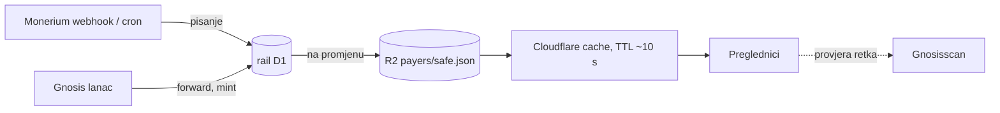

# 18 — Skalabilnost javnog čitanja: popis uplata pod navalom

> Analiza 22. 10. 2026. Pitanje vlasnika: izdrži li stranica kampanje 1M pregleda u minuti,
> kad oznake uplatitelja (`docs/2026-09-15-dnevnik-izvedbe.md` §22) dolaze s raila izvan lanca?
> Odluka na railu: ADR 0030 (`pay.domovina.ai/docs/decisions/0030-edge-cache-javnog-citanja.md`).
> Cjenik Cloudflarea provjeren isti dan na developers.cloudflare.com.

## 1. Zaključak

- **Stranica izdrži besplatno**: energy je statički export (`wrangler.jsonc` ima samo `assets`),
  a zahtjevi na statičke assets na Workersima su „free and unlimited".
- **Kanal za osvježavanje popisa uplata ne bi izdržao.** Svaka otvorena kartica svakih 20 s
  pita rail `GET /api/payers/:address`, a do 22. 10. je svaki takav zahtjev bio jedan upit na
  D1. Ista D1 baza obrađuje Monerium webhook, intente i forwarde, pa bi publika koja
  gleda kampanju **izgladnjela tok novca**. To je rizik, a ne račun.
- Isporučeno 22. 10. 2026. (rail PR #141, #142): **Cache API** na railu, **lanac kroz rail**
  (`/api/activity`), **ograničenje hladnih promašaja** po IP-u i **indeksi** (§4). Snimka na
  R2 iza CDN-a čeka prvu javnu kampanju (§5).

## 2. Kako je izvedeno (stanje 21. 10.)

Stranica elektrane (`components/beta/beta-page.tsx`) dok je kartica vidljiva svakih
`REFRESH_MS = 20 s` šalje tri upita iz preglednika:

| Upit | Kamo | Što | Vrsta podatka |
|---|---|---|---|
| `fetchSafeActivity` | Blockscout `token-transfers` | EURe prijenosi na Safe | na lancu, javno |
| `readErc20Balance` | `rpc.gnosischain.com` | saldo Safea | na lancu, javno |
| `fetchPayerTags` | rail `/api/payers/:address` (Worker + D1) | oznaka „M. S. ··5625", zaprimljeno a nemintano | izvan lanca, anonimizirana projekcija |

Podjela odgovornosti:

- **Lanac** je izvor istine za namireni novac i preglednik ga čita sam.
- **Rail D1** je izvor istine za ono što lanac ne zna: Monerium je zaprimio uplatu, a EURe
  još nije mintan (prva uplata s novog IBAN-a čeka do ~8 h). Tu su i ime i IBAN, a van izlaze
  samo inicijali, zadnja 4 znaka IBAN-a i `ref = SHA-256(sid)[:16]` (rail ADR 0029).
- Preglednik spaja izvore po `tx_hashes` (`lib/payer-tags.ts`, `railOnlyPending`).

Rail upit (`backend/src/payers/api.ts`) ima `OR EXISTS` po tri puta do adrese i
`lower(o.address)`, pa ne koristi indeks: skenira sve `issue` naloge u stanju
placed/pending/processed. Odgovor je nosio `Cache-Control: public, max-age=5`, koji **nije
radio ništa**: Worker se izvršava ispred CDN-ova cachea, pa CDN njegov odgovor ne sprema
sam od sebe, a preglednik pita tek nakon 20 s.

## 3. Proračun za 1M pregleda u minuti

Littleov zakon: 16.700 dolazaka/s × ~2 min na stranici ≈ **2M otvorenih kartica**. Uz jedan
upit u 20 s to je **~100.000 zahtjeva/s po izvoru** (rail, Blockscout, RPC).

| Sloj | Granica | Pri 100k/s |
|---|---|---|
| Statički assets | bez ograničenja, besplatno | 0 $ |
| D1 | jednonitna po bazi: „at 1 ms per query, at most 1,000 queries per second", višak u red, pa `overloaded` | 100× preko granice; puca već oko ~20k istovremenih kartica (1.000 qps × 20 s), a ranije ako upit traje dulje od 1 ms |
| Workers zahtjevi | 10M uključeno, pa 0,30 $/M | 360M/h → ~108 $/h |
| D1 pročitani retci | 25 mlrd uključeno, pa 0,001 $/M | ~1.000 redaka po upitu (sken) → ~360 $/h |
| Blockscout, javni RPC | tuđi servisi, ograničenje po IP-u | na internetu se raspodijeli; **na sajmu je Arena na jednom NAT-u**, pa i nekoliko stotina mobitela na WiFi-ju štanda može dobiti 429 |

Troškovi u tablici vrijede samo ako bi sustav uopće radio. D1 javi `overloaded` puno prije
nego račun naraste. Na Workers Free planu (100k zahtjeva/dan) kvota nestane u sekundi.

Realna veličina: ZEZ je skupio 140.000 € u 10 dana (`docs/13`). Hrvatska kampanja je bliže
1–10 tisuća istovremenih gledatelja nego 2M. Zato je stvarni nalaz **dijeljena baza s
novcem**, a ne cijena.

## 4. Korak 1 — Cache API na railu (isporučeno 22. 10. 2026.)

Rail ADR 0030, `backend/src/payers/api.ts` (`payersBody`):

- Tijelo odgovora ide u `caches.default` po ključu `<origin>/api/payers/<adresa malim slovima>`.
- **Svježe 10 s** (`PAYERS_FRESH_S`): odgovor iz cachea, D1 se ne dira.
- **10–60 s** (`PAYERS_STALE_S`): vrati se stari odgovor, a osvježavanje ide u `waitUntil`
  (stale-while-revalidate, ručno, jer ga Cache API ne radi sam).
- **Spajanje istovremenih promašaja** po izolatu: hladan promašaj pod navalom pokrene jedan
  D1 upit, ne po jedan za svaki istovremeni zahtjev.
- U cacheu je golo tijelo, a CORS zaglavlja dodaje middleware za svaki zahtjev posebno, pa
  cache ne može vratiti tuđi `Access-Control-Allow-Origin`.

Učinak: D1 vidi najviše oko jedan upit po adresi u 10 s **po podatkovnom centru**. Hrvatski
promet ide kroz nekoliko PoP-ova (Zagreb, Beč, Frankfurt), pa je to desetak upita u minuti,
koliko god ljudi gledalo. Worker zahtjevi se i dalje naplaćuju (~108 $/h pri 100k/s), ali
baza s novcem je zaštićena.

Cijena za korisnika: zaprimljena uplata na tuđem ekranu kasni do 10 s više. Prvi zahtjev
nakon duge tišine može dobiti odgovor star do 60 s, a već sljedeći je svjež.

Isti dan, drugi krug (rail PR #142, migracija 0033):

- **`GET /api/activity/:address`**: dolazni EURe s Blockscouta i `balanceOf` s RPC-a, kroz
  isti cache. Energy (`lib/beta-chain.ts`, `RailProfile.activityViaRail`, samo Gnosis) čita
  lanac kroz rail. Ako rail ne odgovori ili vrati neispravan odgovor, čita izravno kao
  prije. Brza ponovna čitanja nakon vlastite uplate (`SETTLE_RETRY_MS`) idu izravno, da 10 s
  cachea ne sakrije upravo stigao prijenos. Izmjereno uživo: 1,3 s bez cachea, 60–90 ms
  iz cachea, 44 prijenosa kao i izravno s Blockscouta.
- **`PUBLIC_READ_LIMITER`** (vezivanje `ratelimit`, 60/min po IP-u) broji samo hladne
  promašaje. Nasumične adrese tako ne mogu zakucati D1, a gledatelji iza jednog NAT-a ne
  troše ograničenje jer dobivaju pogotke.
- **Indeksi** (migracija 0033): upit uplatitelja ide kroz `UNION` tri indeksirana puta, a
  test provjerava plan upita.

## 5. Korak 2 — snimka na R2 iza CDN-a (kad krene javna kampanja)

Ideja vlasnika, 22. 10.: put čitanja se odvoji od Workera i D1.

1. **Piše se kad se nešto promijeni, ne izračunava na svaki zahtjev.** Kad rail promijeni
   nalog ili forward za adresu (webhook, cron, admin), prepiše objekt
   `payers/<safe>.json` u R2. Promjena ima nekoliko na sat, a čitanja može biti milijune.
2. **R2 bucket na vlastitoj domeni** (prijedlog `c.mpt.hr`, uz pretpostavku da je zona `mpt.hr`
   na istom Cloudflare računu) s proxyjem kroz Cloudflare. Klijent poll-a taj URL.
3. **Pogodak u cacheu ne stigne do R2**, pa nema ni `GetObject` operacije (Class B,
   0,36 $/M), a izlazni promet R2 je besplatan. R2 se naplaćuje samo kod promašaja: otprilike
   jedan zahtjev po PoP-u po TTL-u, a sa Smart Tiered Cache još manje. Nema Worker zahtjeva
   ni D1 upita, pa trošak više ne ovisi o navali.

Zamke iz dokumentacije koje treba poštovati:

- **CDN ne sprema JSON po zadanim postavkama** („does not cache HTML or JSON by default").
  Treba Cache Rule „Eligible for cache" na `c.mpt.hr/*` s Edge TTL-om od oko 10 s. Bez toga
  svaki zahtjev ide do R2 i plaća se.
- **Ne `r2.dev`**: tamo nema cachea i ograničen je („rate-limited, development only").
- **Prepisivanje objekta ne briše cache**: zastarjelost je ograničena TTL-om. Ako treba brže,
  rail nakon upisa može zvati purge po URL-u, ali za 10 s TTL to ne vrijedi truda.
- CORS na bucketu: dopustiti samo podrijetla tenanta, kao `ALLOWED_ORIGINS` na railu.
- Opt-in po tenantu (`public_payer_tags`) mora se poštovati i pri upisu. Ako se zastavica
  ugasi, objekt se briše, a ne ostavlja da istekne.

Uz to, u istu snimku ide i stanje s lanca koje danas služi `/api/activity` (§4). **Provjerljivost se ne gubi**: lanac ostaje izvor istine, snimka je
izvedena predmemorija koja se može baciti, a uz svaki redak ostaje link na Gnosisscan.

## 6. Što se ne radi

- **WebSocket / SSE preko Durable Objecta**: promjena ima nekoliko na sat. Datoteka iz CDN-a
  koja se dohvaća svakih 15–20 s jednostavnija je i jeftinija od milijun otvorenih socketa.
- **Osvježavanje češće od 15 s** ne treba: uplata sama putuje sekundama do minutama.

## 7. Otvoreno

1. Odluka o `c.mpt.hr` (zona, ime) prije koraka 2 (§5).
2. `/api/activity` je javni proxy za bilo koju adresu na Gnosisu. Ograničenje hladnih
   promašaja čuva Blockscout od nas. Ako zloupotreba postane stvarna, proxy se suzi na
   adrese koje rail poznaje (`tenant_rail`, projektni Safeovi).
