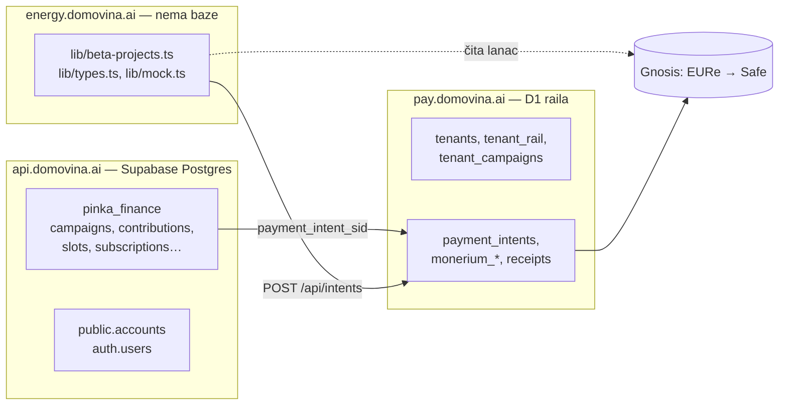
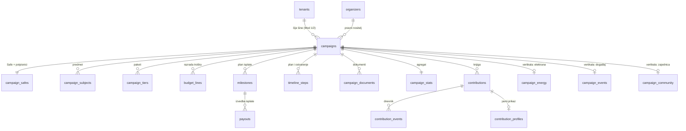

# 19 — Podatkovna jezgra kampanje: `pinka_finance` (Postgres) ↔ D1

**Datum:** 1.11.2026. · **Stanje:** D1–D3 odlučeni (§10); **J1 izveden** u repou
[`domovinatv/campaign-core`](https://github.com/domovinatv/campaign-core) `v0.1.1`, ostalo plan.
**Cilj vlasnika:** od prvog dana fleksibilna P2P platforma za zajedničko financiranje
na Cloudflareu (D1), na kojoj su elektrane prva vertikala, a ne cijeli model.

Dokument odgovara na tri pitanja:

1. Jesu li tri beta elektrane kampanje u `pinka_finance` na `api.domovina.ai`? (§1)
2. Što od strukture pinka kampanja nedostaje ovom repou i obrnuto? (§3, §4)
3. Kako uskladiti relacijsku shemu Postgresa i D1 tako da jedna jezgra nosi svaku
   vrstu kampanje? (§5 – §9)

Odluke koje traže čovjeka su u §10. Dok se ne donesu, ništa iz §7 se ne izvodi.

---

## 1. Stvarno stanje (čitano 1.11.2026.)

Izvor: live Postgres iza Supabasea, `domovina-api/scripts/db-psql.sh` (SSH na Coolify
host + `docker exec psql`), samo `SELECT` i `pg_dump --schema-only -n pinka_finance`.
Ništa nije upisano.

**Tri elektrane nisu u `pinka_finance`.** U `pinka_finance.campaigns` postoje samo
**dvije** kampanje, i nijedna nema `destination_address` jednak Safeu Lukavca
(`0x4f7f…0173`), Donje Lomnice (`0x52ea…78fa`) ni Raba (`0x7CA5…4F05`):

| slug | type | state | visibility | subject_type |
|---|---|---|---|---|
| `podrzi-domovina-podcast` | donation | active | public | podcast_channel |
| `domovina-tv-sponzorski-trenuci` | crowdfund | active | unlisted | podcast_channel |

Elektrane postoje samo kao **kampanje na railu** (pay.domovina.ai D1,
`tenant_campaigns`, registrirane 2.10.2026., [15](./15-pravi-projekti-vlastite-lokacije.md) §6),
a opis projekta živi u kodu (`lib/beta-projects.ts`). Stavka iz [11](./11-plan-izvedbe.md) §1f
„kampanje u `pinka_finance`” nije izvedena, i pitanje iz [15](./15-pravi-projekti-vlastite-lokacije.md)
§10 (vide li se projekti i na domovina.ai) i dalje je otvoreno.

**Koliko se pinka shema stvarno koristi** (broj redaka):

| tablica | redaka | | tablica | redaka |
|---|---|---|---|---|
| `campaigns` | 2 | | `payouts` | **0** |
| `campaign_subjects` | 7 | | `campaign_tiers` | **0** |
| `contributions` | 71 (sve `onchain`: 58 `paid`, 13 `pending`) | | `events`, `tickets` | **0** |
| `contribution_events` | 129 | | `token_positions`, `yield_positions` | **0** |
| `subscriptions` | 3 | | `organizer_records` | **0** |
| `slot_maps` / `slots` | 2 / 14.479 | | | |

Zaključak: u produkciji radi **kampanja + doprinos + dnevnik događaja + ponavljanje +
slotovi** (sponzorski trenuci). Isplate, razine, ulaznice i podaci o organizatoru
postoje u shemi, ali nikad nisu dobili nijedan red. To je bitno za §5. Shema je
široka, ali iskustvo s njom je usko.

---

## 2. Dvije baze, a zapravo tri mjesta

- **Postgres `pinka_finance`**: bogata relacijska shema s RLS-om i ~70 SQL funkcija
  (`create_contribution`, `mark_contribution_paid`, `reserve_slots`, …). Korisnik je
  `public.accounts`. Jedan vlasnik, bez pojma tenanta.
- **D1 raila**: vlasnik **novca** (intent, Monerium nalog, prosljeđivanje, potvrda o
  uplati). O kampanji zna samo `campaign_id → safe_address` (`tenant_campaigns`).
- **energy**: nema bazu. Projekt je TypeScript konstanta, a doprinosi se čitaju s
  lanca i s raila (`/api/payers`, `/api/activity`).

„Usklađivanje dviju baza” je zato zapravo pitanje **gdje živi kampanja kao
podatak**. Novac već ima dom (rail), a kampanja ga nema.

---

## 3. Što pinka ima, a energy nema

Redom po važnosti za fleksibilnu platformu. Stupac „u jezgru?” je prijedlog (§5).

| # | Pinka struktura | Što rješava | energy danas | u jezgru? |
|---|---|---|---|---|
| G1 | `campaigns.type` + `subject_type`/`subject_ref` + `campaign_subjects` | jedna kampanja, više vrsta; polimorfna veza na predmet (kanal, elektrana, događaj) | `Project.plant_id` tvrdo veže na elektranu | **da** — srž fleksibilnosti |
| G2 | `campaigns.visibility` (`private/unlisted/public`) | zatvorena beta bez posebnog koda | `Visibility` postoji samo za elektranu; beta je „neindeksiran link” (B14) | **da** |
| G3 | `contributions` kao **knjiga** s idempotentnim ključevima: `ux_contributions_sid`, `_morder`, `_onchain (tx, log_index)`, `_external_payment` | jedan doprinos = jedan red, bez obzira koliko puta stigne webhook ili ga backfill nađe | nema; doprinos je izveden iz lanca u pregledniku | **da** — najveća rupa |
| G4 | `contribution_events` (append-only) | revizijski trag stanja doprinosa | nema (rail ima `monerium_webhook_events`) | **da** |
| G5 | `campaign_stats` (agregat ažuriran pri upisu) | brzo javno čitanje bez `SUM` po zahtjevu | zbraja se u pregledniku iz lanca | **da** — uz [18](./18-skalabilnost-javnog-citanja.md) |
| G6 | `campaign_tiers` (`kind`, `price_cents`, `inventory_*`, `sale_start/end`) | pakete, ograničene količine | nema | **da**, ali `kind` ograničen (§6.3) |
| G7 | `payouts` sa stanjima `requested → approved → submitted → confirmed` | isplata kao zapis, ne samo kao Safe transakcija | `Project.milestones` je JSON bez stanja isplate | **da**, spojeno s P6 (§4) |
| G8 | `organizer_records` (pravno ime, OIB, adresa, IBAN ili Safe) + `organizer_payment_rails` | tko je nositelj, kamo ide račun | `holder_type/name/oib` kao polja projekta | **da**, kao `organizers` |
| G9 | `subscriptions` + `recurrence` na kampanji | mjesečni doprinos, članarina | nema | **da**, opcionalno po kampanji |
| G10 | prikaz doprinositelja: `anonymous`, `display_name`, `message`, `message_hidden`, `*_verified`, `payer_iban_hash` | javni zid podrške, moderacija | rail `/api/payers` daje oznaku „M. S. ··1234” | **da**, odvojeno od knjige (§6.2) |
| G11 | `latitude/longitude/location_name`, `cover_image_url`, `starts_at/ends_at`, `metadata jsonb` | karta, rok, slobodna proširenja | geo je na elektrani, slike u `BetaPhotos` | **da** |
| G12 | `campaigns_write_guard`, `guard_immutable_slug`, `slugify`, `citext` slug | slug se ne mijenja nakon objave | slug je konstanta u kodu | **da** (trigger u D1) |
| G13 | `events`, `tickets`, `slot_maps`, `slot_zones`, `slots` | ulaznice, sjedala, sponzorski trenuci | nema | **ne** — vertikalni modul |
| G14 | `token_positions`, `yield_positions`, `type` `tokenization`/`realestate` | tokenizacija, prinos na stanje | nema | **nikad** u energy tenantu — pravna granica, [03](./03-pravni-okvir.md) §3 |
| G15 | `buyer_*`, `invoice_*` na doprinosu | B2B račun sponzoru (fiskalizacija) | nema | **ne** u jezgru — modul „račun” (§6.2) |

## 4. Što energy ima, a pinka nema

Ovo nije gubitak koji treba zakrpati, nego **dobitak koji jezgra mora preuzeti**,
inače se u Postgresu nikad ne bi mogao prikazati energy projekt.

| # | energy struktura | Zašto je općenita, a ne samo „solarna” |
|---|---|---|
| E1 | `tenant_id` (rail) i `mode` `integrated`/`byo` + `rails` `platform`/`client` ([14](./14-poslovni-model.md) §6, P1/P2) | Mod 1/Mod 2 vrijedi za svaku kampanju: čiji su IBAN i Safe. Pinka zna samo `account_id` vlasnika |
| E2 | `SafeAccount` s `owners`, `threshold`, `platform_signer_count` i invarijantom `violatesConflictInvariant` (P7) | pinka ima samo `destination_address` + `safe_deployed_at`; nema provjere tko sve potpisuje |
| E3 | `cost_breakdown` s `is_contractor_margin` (P5) | javna razrada troška vrijedi za svaku kampanju s izvođačem |
| E4 | `milestones` (P6) — isplata po situaciji | to je ono što `payouts` treba kao plan; pinka ima izvedbu bez plana |
| E5 | `contractor` + trajna objava sukoba interesa ([14](./14-poslovni-model.md) §4) | općenito: svaka kampanja u kojoj platforma zarađuje na izvedbi |
| E6 | `ProjectDocument` (`site_right`, `statute`, `installer_quote`, …; `url: null` = nije priložen) | dokumenti kampanje, općenito |
| E7 | `TimelineStep` s `planned` i `actual` (K1) | vremenska crta s planom i ostvarenjem; kašnjenje se vidi |
| E8 | `ProjectState` `review`, `building`, `completed` | pinka staje na `funded/closed`; isporuka nakon prikupljanja nema stanje |
| E9 | `surplus_intent`, `max_coowners` (E5, K2) | namjena viška i gornja granica broja članova su općeniti |
| E10 | `demo: true` (pravilo 3) | sandbox i maketa na istoj shemi |
| E11 | `Community`, `Member`, `share_basis_points` | energetska zajednica / zadruga; vertikala, ali ne samo solarna |
| E12 | `short_ref`, potvrda o uplati, oznaka uplatitelja (rail) | već je na railu; jezgra se samo poziva na `sid` |

Vertikalno solarno ostaje samo: `plant_id`, snaga, broj priključaka, HEP-ODS status,
`site_right` kao pravo na krov, Gnosis node, HEP očitanja ([05](./05-podatkovni-model.md) §2, §7).

---

## 5. Prijedlog: jezgra + vertikale

[05](./05-podatkovni-model.md) §3 je 15.9. odlučio **zamijeniti** pinkin `campaigns`
vlastitim `project` entitetom, „jer energetski projekt nosi polja koja kampanja nema”.
Za cilj iz zaglavlja to je pogrešan smjer. Prijedlog ga obrće:

> **`campaign` je jezgra.** Svaka vrsta (donacija, članski ulog, nagrade, ulaznice,
> elektrana) je **ista tablica** plus **vertikalna tablica 1:1** po vrsti.
> Elektrana je `campaign` + `campaign_energy`.

To je class-table inheritance, i pinka je to već napola izvela (`events` je 1:1 s
kampanjom, `campaign_subjects` je polimorfna veza). Razlika je u tome da se
vertikala ne smije prelijevati u jezgru, kao što se B2B račun prelio u
`contributions` (58 stupaca, §6.2).

### 5.1 Jezgra (tablice koje ima svaka kampanja)

| tablica | izvor | ključna polja |
|---|---|---|
| `campaigns` | pinka `campaigns` + energy `Project` | `id`, `tenant_id`, `organizer_id`, `slug` (NOCASE, nepromjenjiv nakon `active`), `type`, `vertical`, `title`, `description`, `goal_cents`, `min_contribution_cents`, `max_contributors`, `currency`, `state`, `visibility`, `mode`, `rails`, `starts_at`, `ends_at`, `recurrence`, `cover_image_url`, `lat`, `lng`, `location_name`, `surplus_intent`, `demo`, `metadata` (JSON), `created_at`, `updated_at`, `deleted_at` |
| `campaign_safes` | energy `SafeAccount` + pinka `destination_address`, `chain`, `safe_deployed_at` | `campaign_id` PK, `address`, `chain_id`, `threshold`, `owners` (JSON), `platform_signer_count`, `deployed_at`, `verified_at` (zadnji `check-beta` s lanca) |
| `organizers` | pinka `organizer_records` + energy `holder_*` | `id`, `holder_type`, `legal_name`, `oib`, `address`, `country_code`, `contact_email`, `is_platform` (mi kao izvođač/nositelj) |
| `campaign_subjects` | pinka 1:1 | `campaign_id`, `subject_type`, `subject_ref` (npr. `plant:<id>`, `podcast_channel:<id>`) |
| `campaign_tiers` | pinka | kao pinka, `kind` ∈ `reward`, `ticket`, `none` |
| `budget_lines` | energy `cost_breakdown` | `campaign_id`, `sort`, `label`, `amount_cents`, `is_contractor_margin` |
| `milestones` | energy `milestones` | `id`, `campaign_id`, `key`, `label`, `amount_cents`, `sort` |
| `payouts` | pinka `payouts` | `milestone_id` (novo), `amount_cents`, `destination`, `state`, `safe_tx_hash`, `tx_hash`, `requested_by` |
| `timeline_steps` | energy `TimelineStep` | `campaign_id`, `key`, `planned`, `actual`, `note`; skup ključeva po vertikali |
| `campaign_documents` | energy `ProjectDocument` | `campaign_id`, `kind`, `label`, `url` (NULL = nije priložen), `issued_at` |
| `contributions` | pinka, očišćeno (§6.2) | knjiga s idempotentnim ključevima |
| `contribution_events` | pinka 1:1 | append-only |
| `contribution_profiles` | pinka `anonymous`, `display_name`, `message`, `*_verified` | javni prikaz, moderacija |
| `campaign_stats` | pinka 1:1 | `raised_cents`, `contribution_count`, `contributor_count`, `last_contribution_at` |
| `subscriptions` | pinka | opcionalno, za kampanje s `recurrence ≠ none` |

### 5.2 Vertikale

| tablica | sadržaj |
|---|---|
| `campaign_energy` | `campaign_id` PK, `plant_id`, `power_kw`, `connections`, `grid_status`, `site_right`, `site_right_doc_id`, `gnosis_node`, `contractor` |
| `campaign_community` | `legal_form`, `registration_state`, `statute_doc_id` + `members` (`role`, `share_basis_points`) |
| `campaign_events` | pinka `events` + `tickets` + `slot_*` kad zatreba (nije sada) |

Pravilo: **jezgra ne zna za vertikalu.** Javni popis, karta, kartica kampanje,
doprinos, isplata i statistika rade samo nad jezgrom. Vertikala dodaje polja na
stranici kampanje i vlastitu validaciju.

---

## 6. Mapiranje polja i vrijednosti

### 6.1 `campaigns`

| pinka | energy (`Project` / `BetaProject`) | jezgra | napomena |
|---|---|---|---|
| `id uuid` | `id` / — | `id TEXT` (UUIDv7) | sortabilan po vremenu |
| `account_id` | — | `created_by` | tko je upisao |
| — | (rail tenant) | `tenant_id` | čije šine; FK na rail `tenants.id` po vrijednosti |
| organizer (implicitno = account) | `holder_*` | `organizer_id` | |
| `slug citext` | `slug` | `slug TEXT COLLATE NOCASE` | unique po tenantu |
| `type` | `model` | `type` | §6.3 |
| `subject_type`, `subject_ref` | `plant_id` | `campaign_subjects` + `vertical` | |
| `goal_cents bigint` | `goal_cents` / `goalCents` | `goal_cents INTEGER` | |
| `min_contribution_cents` | isto | isto | |
| — | `max_coowners` | `max_contributors` | |
| `destination_address`, `chain`, `safe_deployed_at` | `destination_address`, `safe`, `signers` | `campaign_safes` | |
| `state` | `state` | `state` | §6.4 |
| `visibility` | — | `visibility` | |
| `starts_at`, `ends_at` | `deadline` | `starts_at`, `ends_at` | |
| `recurrence`, `recurrence_anchor_day` | — | isto | |
| `cover_image_url` | `photos` | `cover_image_url` + `campaign_media` (kasnije) | `BetaPhotos` ima 3 uloge: prije, render, poslije |
| `latitude`, `longitude`, `location_name` | `address`, `county` (beta) / plant geo | `lat`, `lng`, `location_name` | |
| `metadata jsonb` | — | `metadata TEXT CHECK(json_valid)` | pinka ondje drži `safe` i `kind`; u jezgri oba postaju stupci |
| `youtube_channel_id` | — | `campaign_subjects` (`youtube_channel:<id>`) | ne u jezgru |
| `deleted_at` | — | isto | soft delete |
| — | `mode`, `rails`, `surplus_intent`, `demo` | isto | E1, E9, E10 |
| — | `raised_cents` | **nije stupac** | `campaign_stats` |

### 6.2 `contributions`: knjiga, a ne sve o uplati

Pinka `contributions` ima 58 stupaca: knjigu, prikaz, B2B račun, rezervaciju slotova i
obavijest vlasniku. U D1 se dijeli:

| jezgra | pinka stupci |
|---|---|
| `contributions` (knjiga) | `id`, `campaign_id`, `tier_id`, `quantity`, `amount_cents`, `amount_received_cents`, `currency`, `state`, `payment_rail`, `payment_intent_sid`, `monerium_order_id`, `tx_hash` (bio `forward_tx_hash`), `log_index`, `onchain_from`, `external_payment_ref`, `payer_iban_hash`, `underpaid`, `created_at`, `paid_at` |
| `contribution_profiles` | `anonymous`, `display_name`, `display_name_verified`, `message`, `message_hidden`, `link_url`, `link_preview`, `contributor_verified`, `bank_verified`, `identity_double_verified` |
| modul `invoices` (ne jezgra) | `buyer_*`, `invoice_*`, `terms_accepted_at` |
| modul `slots` (ne jezgra) | `reserved`, `reserve_expires_at`, `desired_slot_keys`, `slot_unassigned`, `sold_slots`, `holders`, `is_sponsor`, `logo_path`, `owner_notified_at`, `owner_notify_attempts` |

Jedinstveni ključevi iz pinke prelaze 1:1 kao parcijalni indeksi (SQLite ih podržava):
`(payment_intent_sid)`, `(monerium_order_id)`, `(tx_hash, log_index)`,
`(payment_rail, external_payment_ref)`, svaki `WHERE … IS NOT NULL`.

`ContributionRail` energyja (`sepa | eure | card`) i pinka `payment_rail`
(`onchain`, …) spajaju se u `payment_rail` ∈ `sepa`, `onchain`, `card`.
`share_basis_points` i `member_id` idu u `campaign_community`, ne u knjigu.

### 6.3 `type`: pravna granica kao `CHECK`

| pinka `campaign_type` | energy `ProjectModel` | jezgra `type` | dopušteno u energy tenantu |
|---|---|---|---|
| `donation` | `donation` | `donation` | da |
| — | `community` | `membership` (članski ulog) | da |
| `crowdfund` (sponzorstvo s nagradama) | — | `reward` | da, uz copy bez prinosa |
| `tickets` | — | `tickets` | da, kad zatreba |
| `tokenization` | — | — | **ne** |
| `realestate` | — | — | **ne** |

`tokenization`, `realestate`, `tier_kind = token_tranche`, `token_positions` i
`yield_positions` **ne ulaze u D1 shemu uopće**, ni kao neaktivne vrijednosti.
`CHECK (type IN (…))` je tada kontrola usklađenosti iz [14](./14-poslovni-model.md)
§2.4, kao lint na zabranjene riječi. Ako ih pinka treba za svoj proizvod, ostaju u
Postgresu i mapiranje ih odbija (§8).

### 6.4 `state`: prikupljanje i isporuka su dvije osi

Pinka ima samo os prikupljanja, energy ih je pomiješao u jednom enumu. Jezgra ih
razdvaja:

| `state` (prikupljanje) | pinka | energy |
|---|---|---|
| `draft` | `draft` | `draft` |
| `review` | — | `review` |
| `active` | `active` | `active` |
| `funded` | `funded` | `funded` |
| `closed` | `closed` | `expired` (rok prošao bez cilja) |
| `cancelled` | `cancelled` | — |

Isporuka (`building`, `completed`) nije stanje kampanje nego **izvedeno** iz
`timeline_steps`: zadnji korak s `actual ≠ NULL`. Kampanja za podcast nema korake
isporuke, a elektrana ima šest (`submitted … connected`).

---

## 7. Postgres → D1: što se mijenja u izvedbi

| Postgres (pinka) | D1 (SQLite) | posljedica |
|---|---|---|
| `ENUM` tipovi | `TEXT` + `CHECK (x IN (…))` | promjena skupa vrijednosti traži migraciju koja prepisuje tablicu; zato su skupovi u §6 zatvoreni |
| `uuid`, `gen_random_uuid()` | `TEXT`, ID generira Worker (UUIDv7) | |
| `timestamptz` | `INTEGER` unix ms | isto kao rail; jedna konvencija u obje D1 baze |
| `jsonb` + GIN | `TEXT CHECK(json_valid(x))` + generirani stupac s indeksom ako se po polju filtrira | |
| `citext` | `COLLATE NOCASE` | |
| RLS + PostgREST javni `SELECT` | nema; autorizacija u Workeru, javno čitanje kroz Worker + Cache API | [18](./18-skalabilnost-javnog-citanja.md): javni promet ne ide ravno u bazu |
| ~70 SQL funkcija (RPC) | TypeScript u Workeru | logika `create_contribution`, `mark_contribution_paid`, `request_payout` se prepisuje, ne kopira |
| transakcija u funkciji | `db.batch([...])` je atomaran; interaktivne transakcije ne postoje | višekoračni upis se slaže kao jedan batch s uvjetima u `WHERE` |
| triggeri `updated_at`, `campaigns_write_guard`, `guard_immutable_slug`, `tg_contribution_*` | SQLite triggeri rade u D1 | `updated_at`, nepromjenjiv slug i `campaign_stats` mogu ostati triggeri |
| FK `ON DELETE CASCADE` | radi (D1 provodi FK) | brisanje kampanje je soft delete; kaskada samo za vertikalu |
| `auth.users`, `public.accounts` | nema | identitet doprinositelja je `payer_iban_hash` / adresa; računi korisnika su zasebna odluka (§10, D5) |

**Globalna distribucija, iskreno:** D1 ima jednog primarnog pisača. Čitanja se mogu
replicirati u druge regije (read replication + Sessions API za čitanje vlastitog
upisa; prije izvedbe provjeriti trenutno stanje u dokumentaciji). Za ovaj promet,
pisanje rijetko i čitanje masovno, to je dovoljno, a skaliranje čitanja ionako ide
kroz Cache API ([18](./18-skalabilnost-javnog-citanja.md)). Kad jedna baza postane
premala (10 GB po bazi), dijeli se po tenantu, a ne po tablici. Zato `tenant_id`
stoji u jezgri od prvog dana.

---

## 8. Gdje jezgra živi i kako se dvije baze drže usklađenima

### 8.1 Gdje: zasebna D1 baza, ne rail i ne energy

| opcija | za | protiv |
|---|---|---|
| a) tablice u D1 raila | jedan deploy, `tenant_id` već postoji | ista baza nosi Monerium webhook; [18](./18-skalabilnost-javnog-citanja.md) upravo to razdvaja; rail mora ostati uzak (vlasnik novca) |
| b) D1 u energy repou | blizu UI-ja | solardei i sandbox bi opet kopirali shemu; protivno „rail + jezgra + N frontenda” ([2026-10-05](./2026-10-05-solardei-rail-i-zajednicka-jezgra.md) §1) |
| **c) zasebna D1 `campaign-core` + Worker** | jedna shema za sve frontende; rail ostaje vlasnik novca; javno čitanje odvojeno od webhooka | jedan servis više |

**Prijedlog: c.** Granica odgovornosti:

- **rail** je izvor istine za **novac**: intent, nalog, prosljeđivanje, potvrda;
- **jezgra** je izvor istine za **kampanju** i drži **projekciju** knjige doprinosa,
  idempotentno po `sid` / `(tx_hash, log_index)`;
- **lanac** je konačni dokaz; projekcija se uvijek može ponovo izgraditi iz raila i lanca.

Rail već ima `webhook_outbox`. Jezgra se na njega pretplati kao još jedan primatelj,
pa ne treba nova veza.

### 8.2 Kako: zajednički ugovor, ne zajednička baza

Tri moguća načina usklađivanja Postgresa i D1:

1. **Sve preseliti u D1.** Ne sada: pinka ima Flutter klijente, Supabase auth, RLS i
   14.479 slotova. Za prvi dan energyja ne treba.
2. **Dvosmjerna sinkronizacija.** Ne: dva pisača iste kampanje = sukobi bez vlasnika.
3. **Zajednički ugovor jezgre + jednosmjerna projekcija.** ← prijedlog

Ugovor je jedna datoteka u paketu jezgre (`campaign-core`, isti paket iz
[2026-10-05](./2026-10-05-solardei-rail-i-zajednicka-jezgra.md) §7.4): za svaku
tablicu jezgre popis stupaca, tip, dopuštene vrijednosti i ime u pinki. Iz nje:

- **test ugovora za D1:** migracije jezgre moraju imati točno te stupce i `CHECK`ove;
- **test ugovora za Postgres:** snimka `pg_dump --schema-only -n pinka_finance`
  (čita se kroz `db-psql.sh`, kao u §1) mora sadržavati pinka imena iz mapiranja.
  Kad netko u domovina-api preimenuje stupac, test pada **ovdje**, prije nego tiho
  pukne projekcija;
- **mapper** `toPinka(campaign)` / `fromPinka(row)` s odbijanjem `tokenization`,
  `realestate` i `token_tranche` (§6.3).

Vlasništvo pisanja po kampanji je jednoznačno. Kampanja nastaje u **jednoj** bazi
(`origin` = `d1` ili `pinka`), a druga dobiva samo kopiju za čitanje s
`campaign_subjects` = `external:<origin>:<id>`. Energy kampanje nastaju u D1. Ako se
odluči da se vide i na domovina.ai ([15](./15-pravi-projekti-vlastite-lokacije.md)
§10), jezgra ih jednosmjerno upiše u `pinka_finance.campaigns` s
`visibility = unlisted` i `state` iz jezgre, a doprinosi i dalje idu kroz rail.

---

## 9. Plan izvedbe

Svaki korak ima uski kriterij dovršenosti. Redoslijed je obavezan jer svaki korak
koristi prethodni.

| # | korak | gotovo kad |
|---|---|---|
| J0 | odluke D1–D7 iz §10 | odgovori upisani u ovaj dokument |
| J1 ✅ | paket `campaign-core`: tipovi jezgre, ugovor (§8.2), zatvoreni skupovi (`type`, `state`, `visibility`, `payment_rail`), `violatesConflictInvariant` premješten iz `lib/types.ts` | energy uvozi iz paketa; `npm run verify` prolazi. **1.11.: izvedeno**, vidi §11. Solardei još ne uvozi (§11.3) |
| J2 | D1 migracija `0001_core.sql` (§5.1) + `0002_energy.sql` (§5.2) + testovi ugovora za D1 i Postgres | `wrangler d1 migrations apply --local` prolazi; oba testa ugovora prolaze; `CHECK` odbija `tokenization` |
| J3 | seed: tri beta elektrane iz `lib/beta-projects.ts` u D1 (staging pa produkcija) | `SELECT` vraća 3 kampanje sa Safeom i potpisnicima jednakima `check-beta.mts` |
| J4 | Worker `campaign-core`: javni `GET /campaigns`, `/campaigns/:slug`, `/campaigns/:slug/stats` kroz Cache API | energy `/beta/` čita opis iz API-ja, a pri buildu iz snimke (statički export ostaje radan bez mreže, [06](./06-produkt-landing.md) §6) |
| J5 | projekcija doprinosa: primatelj `webhook_outbox` raila + backfill iz `payment_intents` i lanca | zbroj `contributions` po kampanji = saldo s `balanceOf` minus poznati izlazi; ponovljeni webhook ne stvara drugi red |
| J6 | `budget_lines`, `milestones`, `payouts`, `timeline_steps`, `campaign_documents` za tri elektrane | stranica elektrane ne čita nijedan od tih podataka iz koda |
| J7 | (ako D3 = da) jednosmjerna projekcija u `pinka_finance` | kampanja vidljiva na domovina.ai kao `unlisted`; test ugovora za Postgres u CI-ju |
| J8 | pisanje: `/novi-projekt` (čarobnjak) upisuje u D1, uz validaciju zabranjenih riječi (`lib/forbidden-words.ts`) na tuđem opisu | prvi projekt koji nije naš nastaje bez izmjene koda |

J1–J5 su minimum da „svaka kampanja” bude podatak, a ne kod. J6–J8 su proširenje.
Migracije su samo aditivne ([12](./12-ime-domena-okruzenja.md) §2.1). Shema se zato
slaže široko odmah (§5), a pune se samo tablice koje trebaju tri elektrane.

---

## 10. Odluke koje traže čovjeka

| # | pitanje | prijedlog | posljedica ako se odluči drukčije |
|---|---|---|---|
| D1 | Obrnuti [05](./05-podatkovni-model.md) §3: `campaign` jezgra + vertikala umjesto vlastitog `project` entiteta? | ✅ **da** (vlasnik, 1.11.) | bez toga svaka nova vrsta kampanje je nova shema i novi UI |
| D2 | Gdje živi jezgra: zasebna D1 + Worker (c), rail (a) ili energy (b)? | ✅ **c**, u novom javnom repou `domovinatv/campaign-core` (paket + D1 + Worker) (vlasnik, 1.11.) | a: javno čitanje i webhook dijele bazu; b: solardei kopira shemu |
| D3 | Prikazuju li se energy kampanje i na domovina.ai (jednosmjerno u `pinka_finance`)? | ✅ **kasnije** (vlasnik, 1.11.); J7 ostaje na kraju | ako da odmah, J7 ide prije J6 |
| D4 | Ime u shemi: `campaign` (kao pinka) ili `project` (kao energy UI)? | `campaign` u bazi, „projekt” u copyju | dvije riječi za istu stvar u kodu |
| D5 | Računi doprinositelja: ostaje li identitet samo `payer_iban_hash`/adresa, ili jezgra dobiva korisničke račune (passkey)? | zasad bez računa | računi vežu na domenu, passkey ne migrira ([12](./12-ime-domena-okruzenja.md) §4) |
| D6 | Smije li jezgra uopće poznavati `reward`/`tickets` za energy tenant? | da za `reward`, uz pravni pregled copyja | inače su dopušteni samo `donation` i `membership` |
| D7 | Postaje li D1 jezgra kasnije dom i za pinka kampanje (podcast, sponzorski trenuci)? | odluka nakon J5, s brojkama | ako da, slotovi i ulaznice prelaze kao vertikale |

Sve ovo je vezano uz B1 (pravno mišljenje, [03](./03-pravni-okvir.md) §9.8): `membership`
i `reward` su u jezgri tek kad mišljenje kaže da su izvan ECSPR-a.

---

## 11. J1 izveden (1.11.2026.)

Repo [`domovinatv/campaign-core`](https://github.com/domovinatv/campaign-core), MIT,
tag `v0.1.1`. Energy ga uvozi kao `github:domovinatv/campaign-core#v0.1.1`; paket
se gradi pri instalaciji (`prepare`), `dist/` nije u gitu.

### 11.1 Što je u paketu

| datoteka | sadržaj |
|---|---|
| `src/sets.ts` | zatvoreni skupovi iz §6 (u D1 postaju `CHECK`) + popis odbijenih pinka vrijednosti |
| `src/types.ts` | tip retka za 15 tablica jezgre i 3 vertikalne (§5.1, §5.2) |
| `src/contract.ts` | opis stupaca: SQLite tip, NULL, skup, JSON/boolean, ime u `pinka_finance` |
| `src/invariants.ts` | `violatesConflictInvariant` (preseljen odavde), `violatesModeSigners`, `isUsableAddress`, `isValidThreshold`, `canAcceptContributions`, `currentDeliveryStep` |
| `src/mapping.ts` | pinka ↔ jezgra (§6.3, §6.4) i stari energy model → jezgra; odbija s razlogom |
| `contract/pinka-columns.json` | snimka stupaca `pinka_finance` iz žive baze (`scripts/snapshot-pinka.sh`, samo `SELECT`) |

### 11.2 Što provjerava

- **Tip i opis tablice se ne razilaze**: `TableSpec<T>` traži točno jedan red po
  polju tipa. Provjereno namjerno pokvarenim opisom: brisanje stupca i dodavanje
  nepostojećeg oba ruše `tsc`.
- **Test ugovora prema Postgresu** (bio planiran za J2, izveden odmah jer je jeftin):
  svaka `pinka` referenca mora postojati u snimci, a snimka ne smije biti starija
  od 30 dana. Preimenovanje stupca u domovina-api pada ovdje.
- **Pravna granica**: nijedna odbijena pinka vrijednost nije u skupovima, nijedno
  ime tablice ni stupca ne sadrži `position`/`token`/`accrued`/`principal`.
- Novac je uvijek `INTEGER` `*_cents`, vrijeme uvijek `INTEGER` `*_at`.
- 170 testova u paketu; energy `npm run verify` prolazi (250 testova + build).

### 11.3 Odstupanja od plana

- **Solardei ne uvozi paket.** Kriterij iz §9 J1 traži oba frontenda; solardei
  danas ne koristi nijednu od ovih provjera, a izmjena u tuđem repou ide PR-om.
  Uvoz ide uz solardei korak iz [2026-10-05](./2026-10-05-solardei-rail-i-zajednicka-jezgra.md)
  §7.2, kad se odblokira Monerium.
- **Energy UI još radi na starim tipovima** (`Project`, `ProjectState` s `building`).
  Iz paketa za sada uzima samo invarijantu i provjeru adrese; mapiranje
  (`fromEnergyProjectState` itd.) je spremno za J3, kad podaci prijeđu u D1.
- `DocumentKind` `installer_quote` je u jezgri `contractor_quote` (općenito);
  mapper prevodi.

**Shema kao dijagram (v0.2.0, 2.11.2026.):** [`schema.dbml`](https://github.com/domovinatv/campaign-core/blob/main/schema.dbml)
generiran iz opisa tablica (grupe u boji, veze, bilješke, pogledi), PNG u README-u paketa.
[Otvori u open-diagramu](https://stepanic.github.io/open-diagram/?url=https://github.com/domovinatv/campaign-core/blob/main/schema.dbml).
Opis tablica sada nosi i strane ključeve (`ref`), koje će J2 pretvoriti u `REFERENCES`.

### 11.4 Zamke iz izvedbe

- **`exports` paketa mora imati uvjet `default`.** `check:beta` (`tsx`) učitava
  energy kao CJS, pa traži `require`/`default`; s `import` samim prvi produkcijski
  deploy pao je s `ERR_PACKAGE_PATH_NOT_EXPORTED` (prije objave, produkcija nije
  dirnuta). Popravak je v0.1.1.
- **Lockfile drži stari commit.** Nakon novog taga treba izričit
  `npm install github:domovinatv/campaign-core#vX.Y.Z`; promjena broja u
  `package.json` nije dovoljna.
- **Čitanje žive pinke:** `domovina-api/scripts/lib/db-env.sh` + SSH +
  `docker exec -i … psql -X -f -` iz skripte (`set -eo pipefail`, bez `-u` jer
  zsh `chpwd_functions`). `db-psql.sh -c` lomi navodnike na udaljenom zsh-u, a
  `--stdin` tiho ne vrati ništa. Domovina AI MCP je 1.11. bio na 502, anon
  ključevi u `.coolify-*.env` vraćaju Unauthorized.

### 11.5 Sljedeće: J2

D1 migracije `0001_core.sql` i `0002_energy.sql` u `campaign-core`, izvedene iz
`src/contract.ts` (skupovi → `CHECK`, `unique` s `where` → djelomični indeks), uz
test da je migrirana D1 shema jednaka opisu tablica. Čeka zeleno svjetlo vlasnika.
